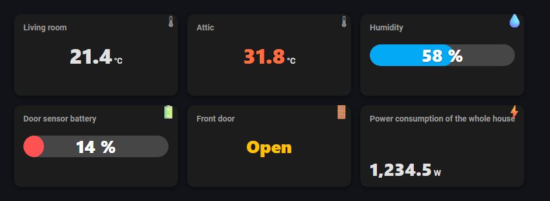

# Bugsa Entity Card

A customizable entity card for Home Assistant Lovelace. Freely position the title, value and icon, color the value with rules, show a progress bar, and let long text shrink to fit. Everything is configurable from the visual editor, which is available in **English and Czech** (it follows your Home Assistant language).



*(Preview rendered from `docs/demo.html`; icons in the preview are stand-ins for Home Assistant's own.)*

## Features

- 9-point positioning of title, value and icon
- **Color rules** for the value and progress bar: numeric (`>`, `>=`, `<`, `<=`, `=`, `!=`) and **text states** (`= open`)
- **Attributes**: show any attribute (e.g. `battery_level`) instead of the state
- Optional **progress bar** with animated fill, value inside / above / below
- **Tap, hold and double-tap actions** (more-info, navigate, call-service, url, ...)
- Auto-shrinking text, per-element font size, weight and color
- Numbers formatted in your Home Assistant language; states translated by Home Assistant
- Keyboard accessible

## Installation

### HACS (custom repository)

1. HACS → ⋮ → **Custom repositories**
2. Repository: `https://github.com/pkejval/bugsa-entity-card`, type **Dashboard**
3. Install **Bugsa Entity Card** and reload the browser.

HACS registers the resource automatically. For a manual install, download `bugsa-entity-card.js` from the [latest release](https://github.com/pkejval/bugsa-entity-card/releases/latest) into `/config/www/` and add the resource `/local/bugsa-entity-card.js` (type: JavaScript module).

## Usage

```yaml
type: custom:entity-customizable-card
entity: sensor.living_room_temperature
```

Or pick **Entity - customizable** in the card picker and use the visual editor.

### Examples

Battery with a progress bar that turns red below 20 %:

```yaml
type: custom:entity-customizable-card
entity: sensor.door_battery
name: Door battery
progress_enabled: true
rules:
  - operator: "<"
    value: 20
    color: [255, 82, 82]
    progress_color: [255, 82, 82]
```

Color by text state, and open a page on tap:

```yaml
type: custom:entity-customizable-card
entity: binary_sensor.front_door
state_color: true
rules:
  - operator: "="
    value: "on"
    color: [255, 193, 7]
tap_action:
  action: navigate
  navigation_path: /lovelace/security
hold_action:
  action: more-info
```

An attribute of a climate entity:

```yaml
type: custom:entity-customizable-card
entity: climate.living_room
attribute: current_temperature
name: Current temperature
```

### Options

| Option | Default | Description |
| --- | --- | --- |
| `entity` | – | Entity to show. Optional if `static_value_text` is set. |
| `attribute` | – | Show this attribute instead of the state (also drives rules and progress). |
| `unit` | entity unit | Override the unit. Attributes have no unit unless set (temperature attributes use the HA unit system). |
| `static_value_text` | `""` | Fixed text shown when no entity is set. |
| `name` | entity name | Custom title. |
| `icon` | entity icon | Custom icon. |
| `show_title` / `show_icon` | `true` | Toggle title / icon. |
| `state_color` | `false` | Color the icon when the entity is active. |
| `title_position`, `value_position`, `icon_position` | `top_left`, `center`, `top_right` | `top_left`, `top_center`, `top_right`, `center_left`, `center`, `center_right`, `bottom_left`, `bottom_center`, `bottom_right`. |
| `tap_action`, `hold_action`, `double_tap_action` | more-info / none / none | Standard Home Assistant [actions](https://www.home-assistant.io/dashboards/actions/). |
| `round_value`, `round_decimals` | `false`, `0` | Round the displayed number. |
| `title_font_size_value/_unit`, `value_…`, `unit_…` | 14 / 30 / 14 `px` | Font sizes (`px`, `rem`, `vw`, `vh`). |
| `title_font_weight`, `value_font_weight`, `unit_font_weight` | 700 / 900 / 700 | Font weights (100–900). |
| `title_color` | theme | RGB array, e.g. `[255, 255, 255]`. |
| `title_overflow_mode`, `value_overflow_mode` | `wrap` | `wrap` or `shrink` (auto-shrink down to `*_min_scale`). |
| `padding_value/_unit`, `gap_value/_unit`, `icon_size_value/_unit` | 16 / 12 / 24 `px` | Spacing and icon size. |
| `rules` | `[]` | List of color rules, see below. Coloring turns on automatically when rules exist. |
| `progress_enabled` | `false` | Show a progress bar for numeric values. |
| `progress_min`, `progress_max` | `0`, `100` | Progress range. |
| `progress_full_card` | `false` | Progress track fills the whole card. |
| `progress_value_position` | `inside` | `inside`, `above`, `below`, `hidden`. |
| `progress_use_value_color_rules` | `true` | Use the matching rule's progress colors. |
| `progress_color`, `progress_track_color` | – | RGB arrays. |
| `progress_length_*`, `progress_thickness_*`, `progress_radius_*` | `100%`, `3vh`, `999px` | Progress bar geometry. |

The full list with defaults is shown in the visual editor.

### Color rules

```yaml
rules:
  - operator: ">"          # >, >=, <, <=, =, !=
    value: 30              # number, or text with = / !=
    color: [255, 110, 64]  # value color
    progress_color: [255, 110, 64]        # optional, progress fill
    progress_value_color: [255, 255, 255] # optional, text on the progress bar
```

The rule with the **nearest threshold** wins; an exact match (`=`) takes priority and `!=` is the last resort. A numeric `value` compares numbers; a text `value` (e.g. `open`) only works with `=` / `!=` and compares case-insensitively.

> **Upgrading from 1.0:** the old `value_color_rule_1..3_*` options still work. As soon as a `rules` list is present, it is used instead.

## Development

```bash
npm install
npm test          # builds and runs the tests
npm run build     # minified bundle into dist/ (committed; HACS serves it)
```

`docs/demo.html` renders several cards with a stub Home Assistant (open it after `npm run build`).

Releases are created by tagging: `git tag v1.2.3 && git push --tags` builds, tests and attaches `dist/bugsa-entity-card.js`.

## Česky

Přizpůsobitelná entity karta pro Lovelace: pozice nadpisu/hodnoty/ikony, barevná pravidla (číselná i textová), atributy, progress bar, akce (klik / podržení / dvojklik), automatické zmenšení textu. Editor je česky i anglicky podle jazyka Home Assistantu.

**Instalace:** HACS → Vlastní repozitáře → `https://github.com/pkejval/bugsa-entity-card`, typ *Dashboard* → Stáhnout.

**Použití:** `type: custom:entity-customizable-card` + `entity`, nebo vyber kartu *Entita - přizpůsobitelná* v editoru. Barevná pravidla se zadávají jako seznam `rules` (viz výše); staré klíče `value_color_rule_1..3_*` dál fungují.

## License

MIT
